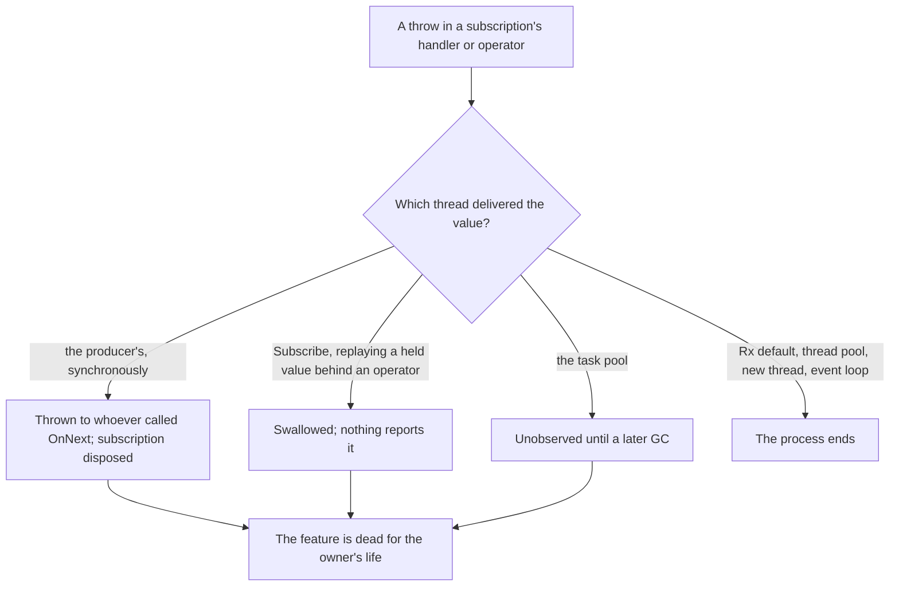

# Exception resilience in .NET applications

Where **one** exception, from ordinary input — a file that went away, a setting edited by hand, text typed
or pasted — silently kills a long-lived feature, vanishes with nothing logged, or ends the process. Each
entry gives the symptom, the cause, what was measured, and the fix.

Scope is plain .NET, System.Reactive and DynamicData. The Avalonia shapes — the dispatcher's global
handler, `DispatcherTimer`, `Dispatcher.InvokeAsync`, a throw from layout, converters and setters under a
binding — are in [avalonia-gotchas.md](avalonia-gotchas.md), under *Dispatcher / exceptions*,
*Bindings / view-model* and *XAML / layout*.

**Measured on** Windows 11 (10.0.26300), .NET 10.0.14 (SDK 10.0.403), System.Reactive 6.1.0 and
DynamicData 9.4.33, 2026-10-31 and 2026-11-01. Each case threw once, ran in its own process, and ran twice, with the same
outcome both times. Every case installs handlers that print a line when
`AppDomain.UnhandledException` or `TaskScheduler.UnobservedTaskException` fires, and a case that expects
the second forces a garbage collection first. So:

- **"the process ends"** means `AppDomain.UnhandledException` fired with `IsTerminating` true and the
  process exited with `0xE0434352` (-532462766), the runtime's code for an unhandled exception. On Linux
  the same ending is exit 134 (SIGABRT).
- **"nothing reported it"** means neither handler printed a line.

One shape behaves differently on Linux, and its entry says so:
[a `FileSystemWatcher` handler](#a-filesystemwatcher-handler-that-throws-ends-the-process-on-windows-and-silences-the-watcher-on-linux).

## What one exception can do

| Outcome | Meaning |
|---|---|
| **DEAD** | the feature stops for good: a subscription disposed, a loop ended, a timer stopped, a watcher silent |
| **SILENT** | nothing reports it, or only a later garbage collection does, whenever that is |
| **ENDS** | the process ends |

The worst are DEAD and SILENT together: the feature stops and nothing says so.

## Where it surfaces: the caller decides

A throw goes to whoever called the code that threw. That one fact predicts most of this document.

| Who called the code that threw | What happens |
|---|---|
| An Rx operator delivering a value synchronously: `Subject.OnNext`, a cache's `AddOrUpdate`, a property setter | thrown back to whoever pushed the value; the subscription is disposed |
| `Subscribe`, delivering a value a `ReplaySubject` or `Replay` holds, or a `BehaviorSubject`'s behind an operator | **swallowed**: nothing reports it, and the subscription is dead |
| Rx's default scheduler, `ThreadPoolScheduler`, `NewThreadScheduler`, an `EventLoopScheduler` | the process ends |
| The task pool: `TaskPoolScheduler`, `Task.Run`, a task nobody awaits, `ContinueWith` | unobserved until a garbage collection finalises the task |
| A `System.Threading.Timer`, `ThreadPool.QueueUserWorkItem`, a `Thread`, a finalizer, `Process.OutputDataReceived`, `ErrorDataReceived` and `Exited`, async void with no synchronisation context | the process ends |
| A `System.Timers.Timer` | swallowed; the timer keeps ticking |
| A `FileSystemWatcher` | Windows: the process ends. Linux: the watcher's `Error` event, and the watcher goes silent |

## The shapes at a glance

The analyzer column is the .NET SDK's own analyzers and the compiler with `AnalysisMode=All`, run over one
sample of each shape.

| Shape | Outcome | Built-in analyzers |
|---|---|---|
| A subscription's handler or operator throws | DEAD; where it surfaces follows the thread | none |
| A time operator with no scheduler, or a thread or pool scheduler | ENDS (task pool: DEAD and SILENT) | none |
| A source that replays at subscription | DEAD and SILENT | none |
| A shared source: `Publish`, `Replay`, `RefCount` | DEAD for every subscriber | none |
| A producer whose `OnNext` sits in a try/catch | DEAD for every subscriber, SILENT | none |
| A DynamicData operator's lambda, a cache subscriber | DEAD; thrown into the writer, or behind `AsObservableCache` not told at all | none |
| `WhenValueChanged` and its kin | DEAD; thrown into the setter | none |
| async void | ENDS | none |
| An async lambda where a void delegate is expected | ENDS, or SILENT | none |
| A task nobody awaits | SILENT until a GC; a loop in it DEAD | CS4014, only inside async methods |
| A continuation that ignores the fault | SILENT until a GC | CA2008, about schedulers |
| Awaiting `Task.WhenAll` | SILENT for every exception but one | none |
| A `System.Threading.Timer` callback | ENDS | none |
| A `System.Timers.Timer` `Elapsed` handler | SILENT | none |
| A `Thread`, a thread-pool work item | ENDS | none |
| A catch that neither rethrows nor logs | SILENT | CA1031, a different question |
| Raising a multicast event | later handlers skipped | none |
| A `finally` or `Dispose` that can throw | the first exception lost; teardown stops | CA2219, throw statements only |
| `Lazy<T>` whose factory can throw | DEAD: the exception is cached | none |
| A static initialiser that can throw | DEAD: the type is unusable | CA1810, a performance rule |
| A semaphore taken without try/finally | DEAD: every later caller waits | none |
| A busy flag reset without finally | DEAD: the feature is skipped | none |
| A `FileSystemWatcher` handler | Windows: ENDS. Linux: DEAD, told only to `Error` | none |
| A `Process` event handler | ENDS | none |
| A finalizer | ENDS | none |
| A cancellation callback | thrown into whoever cancels | none |

---

## Rx and DynamicData

### A throw in a subscription disposes it, and an `onError` does not catch the handler's own throw

**Symptom:** A feature that worked stops: a key does nothing, a list stops updating, a writer stops saving.
Nothing is on screen, and whether anything is in the log depends on the thread.

**Cause:** A throw in the `Subscribe` handler disposes the subscription and goes back up to whoever called
`OnNext`. A throw in an operator's lambda (`Select`, `Where`, `Do`) becomes `OnError`, which
`Subscribe(onNext)` rethrows to the same caller.

**Measured:**

- A handler behind `Select` threw on 1: `OnNext(1)` threw to its caller, the subject had no observers
  left, and 2 never arrived.
- **Given an `onError`, the handler's own throw still went to the caller.** `onError` was never called,
  and the subscription was still dead.
- A `Retry`, DynamicData's `RetryWithBackOff` or a `Catch` ahead of the handler changed nothing: they cover what is
  upstream of them, never the handler.
- A `Subscribe` straight on a `Subject`, with no operator, survived its own throw and took 2. But the throw
  stopped the subject's loop for that value: of three subscribers, the one subscribed after the throwing
  one never saw 1.
- `Observable.FromEventPattern` behind a throwing handler detached itself from the event.

**Fix:** Guard inside the handler: one try/catch that logs, around whatever it calls. Put work that can
fail in an operator ahead of a `Retry`, which resubscribes: there the next value arrived. `Catch` is not
that. Ahead of a throwing `Select` it switched to its fallback and the subscription completed, so 2 never
arrived. Give every `Subscribe` an `onError` that logs, for the operators' failures, but never rely on it
for the handler's.

### A time operator with no scheduler ends the process on a throw, even with an `onError`

**Symptom:** The application closes on input that should only have failed one feature.

**Cause:** An operator that waits — `Throttle`, `Sample`, `Interval`, `Timer`, `Delay`, a time `Buffer` or
`Window`, `Timeout` — emits on Rx's default scheduler when it is given none. A throw there has no caller to
go back to.

**Measured:** A throwing handler ended the process behind each of those operators, behind
`ObserveOn(Scheduler.Default)`, `ThreadPoolScheduler`, `NewThreadScheduler` and an `EventLoopScheduler`,
and from an action scheduled straight on `Scheduler.Default`. **With an `onError` given, the process still
ended.** `Timeout` with no `onError` ended the process **with no user code throwing at all**: its own
`TimeoutException` was rethrown on the timer's thread. Given an `onError`, it reached it.

`TaskPoolScheduler` is the exception: there a throw was unobserved until a forced collection, and the
subscription was dead. A one-shot action scheduled on it failed alone, and the next one ran.

**Fix:** Give every time operator an explicit scheduler: the UI scheduler for work that touches the view, a
pool scheduler otherwise. Then guard the handler, because the pool only turns ENDS into DEAD and SILENT. Do
not leave `scheduler ?? Scheduler.Default` as the production default.

⭐ **Checked by [`BNCQ1005`](codequality.md#bncq1005)**, off until enabled: each operator above called
with no scheduler. A scheduler that was chosen, `Scheduler.Default` included, is not reported.

### A source that replays at subscription swallows a throw on the held value

**Symptom:** A subscription made at construction never runs past its first value, and nothing says why.

**Cause:** A `ReplaySubject` delivers its held value to a new subscriber inside `Subscribe`. If the
handler, or an operator between them, throws on that value, `Subscribe` **returns normally**.

**Measured:** Behind `ReplaySubject(1).AsObservable()`, a throwing handler or a throwing `Select`:
`Subscribe` returned normally, nothing reported it, and 2 never arrived. The same held for a
`BehaviorSubject` behind an operator, and for a late subscriber to a shared `Replay(1).RefCount()`, whose
first subscriber was unaffected.

Not every replaying source swallows. A `BehaviorSubject` subscribed directly, `StartWith`,
`WhenValueChanged`'s initial value and a DynamicData `Connect` over items already held all threw to the
caller of `Subscribe`. A throw on a later value went to the writer, and the other subscribers kept every
value.

**Fix:** Guard the handlers of anything subscribed to a replaying source. Validate a value before it enters
the subject: a setting's write that refuses a value it cannot hold is cheaper than every subscriber
guarding against it.

### One subscriber's throw silences every other subscriber of a shared source

**Symptom:** Every view fed by one source freezes at once.

**Cause:** `Publish().RefCount()`, `Replay(n).RefCount()` and their kin share one upstream subscription. A
source built by `Observable.Create` disposes that subscription when a downstream throw passes through it.

**Measured:** Two subscribers to `Observable.Create(...).Publish().RefCount()`, one throwing on 1: the
producer's subscription was disposed, `OnNext(1)` threw to the producer, and the other subscriber never got
2.

**Fix:** Guard every subscriber of a shared source. One unguarded subscriber is everyone's problem.

### A producer that catches its subscribers' throws talks to a dead observer

**Symptom:** A polling source — a file watcher, a poller — stops for every subscriber, and whatever shows
its state keeps showing the last good one.

**Cause:** The producer catches the exception one subscriber threw out of `OnNext`. By then Rx has disposed
the producer's subscription, so the catch talks to a dead observer.

**Measured:** A producer polling every 50 ms on the task pool, with `OnNext` inside a try/catch, shared
through `Replay(1).RefCount()`. One subscriber threw on poll 3: the producer caught it, and then **polled
no more**: three polls in 600 ms. The other subscriber saw 1, 2 and 3, and nothing after.

**Fix:** Catch only the producer's own work (the read), outside the `OnNext` call. Never call `OnNext`
inside a try whose catch carries on.

⭐ **Checked by [`BNCQ1007`](codequality.md#bncq1007)**: the `OnNext` of the observer
`Observable.Create` hands its delegate, in a try whose catch can carry on.

### A DynamicData lambda's throw goes to whoever wrote to the cache

**Symptom:** A list stops updating. Writing to the cache throws somewhere unrelated.

**Cause:** A `Transform` or a cache subscriber runs inside the write.

**Measured:**

- A `Transform` that threw on item 1: `AddOrUpdate(1)` threw to its caller. The chain's subscriber saw item
  2 and nothing after, and a `Bind` behind it kept only item 2. The cache itself held all three.
- A cache subscriber that threw: `AddOrUpdate` threw, the subscriber connected after it missed that change,
  and the others went on. `SourceList` behaved the same.
- On items already in the cache at `Connect`, the throw went to the caller of `Subscribe`.
- **Behind `AsObservableCache()` the writer was not told at all.** `AddOrUpdate(1)` returned normally, the
  derived cache's subscriber got `OnError`, and the derived cache never changed again: it held one item
  while the source held three.
- A cache used after `Dispose` did not throw.

**Fix:** `TransformSafe`, which takes an error handler and, by DynamicData's documentation, hands it the
factory's exceptions instead of ending the stream. Guard cache subscribers, so a subscriber's failure never
becomes the writer's.

### A throw on a `WhenValueChanged` value goes into the property's setter

**Symptom:** Setting a property throws an exception that has nothing to do with the property, or a
binding's write is lost.

**Cause:** `WhenValueChanged` delivers inside `PropertyChanged`, which the setter raises.

**Measured:** Three subscribers, the middle one throwing on 1: `Value = 1` threw to whoever set it, the
property already held 1, and the subscriber after the throwing one missed it. On the initial value the
throw went to the caller of `Subscribe`. When the setter is a two-way binding's, the binding swallows the
exception (see the binding entry in [avalonia-gotchas.md](avalonia-gotchas.md)).

**Fix:** Guard the handlers. A view model's property must never be a channel for its subscribers'
failures.

### A `CompositeDisposable` stops at the first member that throws, and reads disposed

**Symptom:** Teardown leaves something running: a timer, a watcher, a subscription.

**Measured:** A `CompositeDisposable` of three, the second throwing on `Dispose`: the first was disposed,
the third was not, the exception reached the caller, and `IsDisposed` read true, so nothing will try
again. A subject completed inside an owner's `Dispose` runs its subscribers' `onCompleted` there, and a
throw in one escaped the `Dispose`.

**Fix:** Nothing in a disposable that can fail on input without its own catch that logs. Order a
composite's members so the ones that must not be missed come first.

---

## Async and tasks

### async void ends the process, and the caller's try/catch never sees it

**Symptom:** With no synchronisation context, the process ends. On a UI thread, the exception goes to the
dispatcher's global handler (see [avalonia-gotchas.md](avalonia-gotchas.md)), and the click did nothing.

**Cause:** An async void method has no task to carry its exception, so it is rethrown on the context it
started on, or on the thread pool when there is none.

**Measured:** The caller's try/catch returned normally and the process ended, whether the method threw
after its first await **or before it**.

**Fix:** Return `Task` and await it. Where the signature must be void (an event handler), wrap the whole
body in one try/catch that logs.

### An async lambda given where a void delegate is expected is async void

**Symptom:** As async void, because it is async void: a command given an `Action`, `Subscribe`,
`List.ForEach`, an event `+=`.

**Measured:**

- Given to a method that runs an `Action` inside try/catch: the catch saw nothing, and the process ended.
- Given to Rx's `Subscribe` off a UI thread: the process ended.
- Given to `Select`: each value became a task nobody awaited, and the failure was unobserved until a forced
  collection.
- Given to `Task.Factory.StartNew`: the returned `Task<Task>` completed normally while the inner task
  faulted, unobserved until a forced collection.

**Fix:** Use APIs that take `Func<Task>` and await it: an async command that awaits and logs, `Task.Run`
rather than `StartNew`, and in Rx `SelectMany` with `Observable.FromAsync` in place of an async
`Subscribe` or `Select`.

⭐ **Checked by [`BNCQ1006`](codequality.md#bncq1006)** for System.Reactive's operators: an async
delegate given to `Subscribe`, `Do` or `Finally`, and a `Select` whose tasks nothing awaits. The
other void delegates are `Microsoft.VisualStudio.Threading.Analyzers`' ground.

### A task nobody awaits reports its failure only when a collection finalises it

**Symptom:** Work silently does not happen. If it was a loop, it silently stopped.

**Measured:** A faulted `Task.Run` and a discarded async method's task reported nothing until a forced
collection; then `TaskScheduler.UnobservedTaskException` fired, and the process carried on. A loop inside
such a task, meant to run every 20 ms, stopped at its first throw: three passes, then nothing.

**Fix:** Await it. Where it truly runs alone, attach a continuation that logs the fault, or use a helper
that does; never rely on `UnobservedTaskException`.

CS4014 fired only on the call inside an async method. The same call in a synchronous method, a `Task.Run`
nobody awaits and a `_ =` discard drew nothing.

### A continuation that ignores the fault leaves it unobserved

**Measured:** A continuation that looked only at `Status` completed, and the antecedent's exception was
unobserved until a forced collection. Reading `Result` moved the fault into the continuation, which faulted,
unobserved in turn. `OnlyOnRanToCompletion` cancelled the continuation, and the antecedent's exception was
again unobserved.

**Fix:** `await`. Or read `t.Exception` and log it, as an `OnlyOnFaulted` continuation does.

CA2008 fired on the `ContinueWith`. It asks for a `TaskScheduler`; it says nothing about the fault.

### Awaiting `Task.WhenAll` throws one exception and drops the rest

**Measured:** Two tasks failed. `await` (as `GetAwaiter().GetResult()`) threw the first; the `WhenAll`
task held both, and nothing reported the second.

**Fix:** Catch, then log the `WhenAll` task's `Exception`, an `AggregateException` holding every failure.

---

## Timers and threads

### A `System.Threading.Timer` callback that throws ends the process

**Measured:** A throw on the second tick ended the process.

**Fix:** One try/catch around the whole callback body, logging.

### A `System.Timers.Timer` swallows a throw from `Elapsed` and keeps ticking

**Measured:** A 50 ms timer with two `Elapsed` handlers, the first throwing on its second call. No handler
anywhere reported it, even after a forced collection, and the timer kept ticking: in 600 ms the first
handler ran 11 times and **the second ran 10**, the tick that threw being the one it missed.

**Fix:** A try/catch that logs, inside every `Elapsed` handler. The timer will never tell you.

### A throw on a `Thread` or a thread-pool work item ends the process

**Measured:** A throw ended the process, from a `new Thread` and from `ThreadPool.QueueUserWorkItem`.

**Fix:** A try/catch that logs, at the top of the thread's method or the work item.

---

## Catches

### A catch that neither rethrows nor logs hides the failure from everything

**Symptom:** Whatever the try was for silently did not happen.

**Measured:** An empty catch around a save that threw: nothing reported the exception anywhere, even after
a forced collection.

**Fix:** Log it, even at a low level, with the exception. Where silence is the right answer — a probe, a
`Try` method, a timeout that means "no match" — narrow the caught type to that failure and say why.
`Debug.WriteLine` is `[Conditional("DEBUG")]`, so a catch that writes only with it writes nothing in a
Release build.

CA1031 asks a different question. It flagged the catch of `Exception` that logged as well as the bare
`catch`, and said nothing about an `IOException` caught and dropped.

---

## Events and teardown

### A throwing event handler skips the handlers after it

**Measured:** Three handlers, the second throwing: the third was skipped for that raise, and the raiser got
the exception. The same held among a `System.Timers.Timer`'s `Elapsed` handlers.

**Fix:** Where handlers are not yours to trust, invoke each one from `GetInvocationList()` inside its own
try/catch, logging. Otherwise document that handlers must not throw, and guard them. A hand-written raise
loop over stored handlers is the same shape.

### A throw from `Dispose` or `finally` replaces the exception that was already in flight

**Measured:** A `using` whose body threw and whose `Dispose` threw: the caller saw only `Dispose`'s
exception. The same held for a `finally` that threw.

**Fix:** Nothing in `Dispose` or `finally` that can fail on input without its own catch that logs.

CA2219 fired on a `throw` statement in `finally`, and not on a call there that can throw.

### A cancellation callback's throw reaches whoever cancels

**Measured:** Two callbacks, one throwing: `Cancel()` threw an `AggregateException` to its caller, after
the other callback had run. Teardown that calls `Cancel()` stops at that point.

**Fix:** Guard the callbacks. Treat `Cancel()` in teardown as something that can throw.

---

## Caches, gates and flags

### `Lazy<T>` caches its factory's exception for good

**Measured:** In the default mode the factory ran once, and **the second `Value` rethrew the same
exception**, the cause long gone. With `LazyThreadSafetyMode.PublicationOnly` the second `Value` ran the
factory again and got 42.

**Fix:** `PublicationOnly`, or a factory that catches and answers a fallback.

### A static initialiser that throws leaves the type unusable for the life of the process

**Measured:** `TypeInitializationException` on the first use, and **again on the second, after the cause
was gone**.

**Fix:** No input or output in static initialisers. Load on first use, with retry. CA1810 fires on a static
constructor, but for performance: it would move the same work into a field initialiser.

### A semaphore taken without try/finally stays taken

**Measured:** One throw between `WaitAsync` and `Release` left the semaphore held. The next call had not
completed half a second later, and `CurrentCount` read 0.

**Fix:** `try { … } finally { gate.Release(); }`, or a releaser in a `using`.

### A busy flag reset without finally stays set

**Measured:** One throw left `busy` true, and every later refresh was skipped.

**Fix:** Reset it in `finally`.

---

## Files, processes and finalizers

### A `FileSystemWatcher` handler that throws ends the process on Windows, and silences the watcher on Linux

**Symptom:** On Windows, the application closes when a watched file appears, changes, goes or is renamed.
On Linux, it stops noticing files, and nothing says so.

**Measured** with a handler for `Created`, `Changed`, `Deleted` or `Renamed`, each in a case of its own,
that threw on the first of three files, each created, appended to, deleted or renamed 400 ms apart. All
four events behaved alike:

| Platform | What happened |
|---|---|
| Windows 11, .NET 10.0.14 | the handler ran on a thread-pool thread, and the process ended |
| Linux (Ubuntu 26.04.1 under WSL 2), .NET 10.0.13 | the exception went to the watcher's **`Error` event**, and the watcher raised **nothing for the second or third file**, with `EnableRaisingEvents` still true |

The control for each event, the same watcher with a handler that never throws, saw all three files on
both.

**Fix:** A try/catch that logs, inside every handler. Subscribe to `Error`, and rebuild the watcher there.

### A `Process` event handler that throws ends the process

**Measured:** A throw in `OutputDataReceived`, in `ErrorDataReceived` or in `Exited` ended the process, on
Windows and on Linux. Each handler ran on a thread-pool thread, and each control, a handler that never
throws, saw every line or the exit.

`WaitForExit` raises `Exited` itself, on its caller's thread, when the event has not been raised yet: a
throw from the handler then reaches whoever called `WaitForExit`, as measured on both platforms.

**Fix:** A try/catch that logs, inside the handler.

### A finalizer that throws ends the process

**Measured:** A throw from a finalizer ended the process at the collection that ran it.

**Fix:** Never throw from a finalizer.
