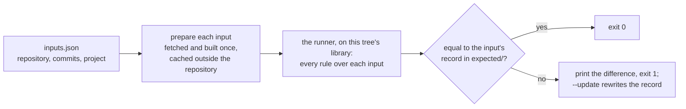

# 00001 — The verification tooling, under `tools/`

> Status: **approved 2026-10-12**. Supersedes nothing.

A change to a rule is ready when the suite passes, the mutations planted in the code it touches each
fail a test, and the real-code comparison against `main` holds (`AGENTS.md`, "Budgeting a change,
before it starts"). A rule that claims something about the framework is also measured, headless,
under Fluent, Simple and Semi. The three tools that do this live in working sessions' scratch
folders, each wired to the round that wrote it, and every round has rebuilt them. This plan moves
them under `tools/`, one command each, and has CI run the real-code comparison, by the developer's
decisions of 2026-10-09 and 2026-10-10.

## Prior art

| Tool | What it does | What wires it to its round |
|---|---|---|
| The real-code comparison: `RealCode`, a 40-line runner, driven by `compare-v11.ps1` | Builds the runner against a library DLL, runs the named rules over a consumer's markup and build output, prints every finding and skip, sorted, and sets two builds' output side by side | Its `main` side is a runner built before `BNXQ1010` existed; its branch side, a library built by copying files into another session's worktree, since removed, at `1c43f6f`; its inputs, paths in two other sessions' folders |
| The mutation runner, `pmutate_fast.py` | Plants one defect at a time in an isolated copy, rebuilds only the library when the defect is in it, runs one test class, and compares the tests that fail with those the catalog expects | `BASE = "1c43f6f"` and an overlay folder of round 11's working copies; the tests run as an `.exe`; `stop-run.ps1` finds its processes through `Win32_Process` |
| The headless probe: `FpProbe6` and `ProbeLib`, driven by `run-probe.ps1` and `tabulate16fix.py` | Holds 603 cases on Avalonia 12.1.3; measures each under the three themes, dumps it as markup, runs `BNXQ1005`, `BNXQ1009` and `BNXQ1010` over it, and judges each verdict against what was measured | A setup script that copies the previous judge's probe and patches `Cases.Every`; a restore source in one user's NuGet cache; runner builds named by judge |

The real-code inputs are other repositories' code: TailBlazer's Avalonia port, before and after its
row-background fix, and ClaudeForge at `70dc713`. TailBlazer's commits were never on a remote, only
on a local branch, and by the developer's decision of 2026-10-12 that branch is obsolete here and
TailBlazer is no longer an input. ClaudeForge is public, and `70dc713` is on its `main`.

## Decisions

| # | Decision | Why |
|---|---|---|
| 1 | **C#, as in `scripts/`.** Each command is a file-based app, run with `dotnet run --file tools/<name>.cs`; the rule runner and the probe are projects, because the probe compiles Avalonia XAML | One toolchain, the one CI already installs, compiled with warnings as errors. Python is `py` on Windows and `python3` elsewhere, and the PowerShell that reaches processes runs only on Windows |
| 2 | **`tools/` stays out of `XamlQuality.slnx` and is never packed.** `tools/Directory.Build.props` imports the root's and sets `IsPackable` to `false`. The probe's package versions go in `Directory.Packages.props` under a `Verification` group, with the warning the `Tool` group carries: the library takes none | Nothing in `tools/` ships, so the three Build & Test jobs and Pack should not restore Avalonia and Skia for it. The guard on the library's dependencies, `AssemblyQualityTests`, scans `src` and is unchanged |
| 3 | **Real-code inputs are pinned by commit.** `tools/real-code/inputs.json` names, for each input, the repository and commit, the folder its markup is read from, the project its assemblies are built from, and the assemblies the rules read. The command fetches each commit shallowly, or reads it with `git archive` from a local clone of its repository given with `--from`, builds it once into a cache outside the repository, and reuses that cache until the manifest changes. The inputs are three. ClaudeForge at `70dc713`: its markup under `src/`, its assemblies built from `src/ClaudeForge/ClaudeForge.csproj`, and the rules reading `ClaudeForge.Avalonia.dll` and `ClaudeForge.dll`. DiffView's `src/DiffView.Avalonia` and ScopedEditors' `src/ScopedEditors.AvaloniaUI`, each pinned at the commit its `main` is at when step 2 is written, and each built from that folder's project alone, the rules reading the assemblies it builds of its own | Nothing of another repository is committed here, and a commit pins the markup exactly. The assemblies are rebuilt rather than stored, so the comparison is pinned only as far as the build is; step 2 shows that a Linux build gives the records a Windows build gave |
| 4 | **The comparison is against a committed record of `main`'s output.** `tools/real-code/expected/<input>.txt` holds what every rule prints over that input: each rule's counts, then its findings and skips one per line, sorted, without the library's hash. The command exits 1 and prints the difference when the tree's output departs from the record, and `--update` rewrites the record. It finds the rules as `RulesCatalogTests.DiscoverRules` does, so a new rule joins the record with nobody adding it | A pull request that changes what a rule says about real code then shows it in its own diff, where its reviewer reads it, and CI holds every other pull request to the record. Building `main`'s library beside the branch's, as the scratch tools did, costs a second build and leaves the result in a log |
| 5 | **TailBlazer is no longer a real-code input, and DiffView and ScopedEditors join ClaudeForge**, by the developer's decisions of 2026-10-12, so the review budget in `AGENTS.md` names those three. A further input is one manifest entry, added in a change of its own | TailBlazer's branch is obsolete here, and its two commits were never on a remote, so CI could not have fetched them. DiffView and ScopedEditors consume these rules, and their libraries restore from nuget.org alone. DiffView themes its own controls, which is what `BNXQ1003` and `BNXQ1006` read |
| 6 | **CI gains one job, `Verification tools`, on Ubuntu.** It restores the input cache with `actions/cache`, keyed by `inputs.json`, runs the real-code comparison, runs the mutation runner's smoke catalog, and builds the probe. It is a required check: `repository.json` lists it, and the developer runs `repo-conventions apply` in the same change, as `.github/AGENTS.md` requires | A comparison that no pull request must pass gets read only by whoever remembers to. One platform is enough, because the records are text and the library writes their paths with `/` (`XamlScanContext.Load`); the three-platform matrix stays in Build & Test, where paths are compared |
| 7 | **The mutation runner is `pmutate_fast.py` ported, its semantics kept.** It plants one defect a run. Workers run in parallel, each with its own copy, build output and temp folder (`TMP`, `TEMP` and `TMPDIR`). A defect under `src/XamlQuality/` rebuilds the library alone and swaps its DLL into the tests' output. Each run is one test class, named on the command line, and the tests that fail are compared with the catalog's `expect`. The file is restored from its bytes and checked by hash. Three things change. A worker copies the working tree, the files `git ls-files --cached --others --exclude-standard` lists, so no commit and no overlay is wired in, and, as before, the tree itself is never edited. The tests run through `dotnet`, so no `.exe` is assumed. And after the baseline it times one library rebuild and one class run, estimates the whole run from them, and refuses a run estimated past 30 minutes unless given `--over-30-minutes`. Ctrl+C stops every process it started, children included, which retires `stop-run.ps1`. The catalog format does not change | Copying the working tree lets the runner check whatever is being changed, with nothing to set first. Workers on copies are why a killed run leaves no defect behind; the serial harness before them edited files in place, and a killed run left one (round 11's `V07`). The 30-minute limit is the developer's, of 2026-10-09, and an estimate is how every run since was cut, by hand |
| 8 | **Catalogs stay with the change that writes them**, outside the repository. One smoke catalog is committed, for CI: two defects in code that rarely changes, each failing a known test | A catalog is aimed at one change's code, and the next refactor leaves much of it stale. The tests are the suite that lasts; a catalog is evidence for one pull request |
| 9 | **The probe moves with its 603 cases, each keeping its id and what it measures**, as `tools/probe/Probe` and `tools/probe/ProbeLib`; where this repository's warnings as errors stop it compiling, it is fixed without changing behaviour. One command, `tools/probe.cs` given a pattern of case ids, does what `run-probe.ps1` and `tabulate16fix.py` did: it builds; measures the matching cases under Fluent, Simple and Semi, in the facts pass and the bound pass; dumps them; runs `BNXQ1005`, `BNXQ1009` and `BNXQ1010` over every dumped case in one runner process; and judges each verdict against the measurements with `tabulate16fix.py`'s functions, unchanged, as holds, agrees, skip, FALSE, MISSED or does not load | The judges' verdicts cite cases by id, so no id and no measurement may move. One runner process, rather than one per case, is the only change to how the rules run, and step 4 shows it prints the same |
| 10 | **Outputs land in `artifacts/`**, which `.gitignore` already ignores. No command writes a tracked file except `real-code.cs --update` | The rule that a build never writes a tracked file, extended to the tools |

The real-code check, as decisions 3 and 4 have it:

### Dismissed

- **Keeping Python and PowerShell.** Two more toolchains in a .NET repository, and one of them
  Windows-only as written.
- **Adding the tools to `XamlQuality.slnx`.** Every Build & Test job, on three platforms, would
  restore and build Avalonia for projects nothing ships.
- **Storing the inputs as release assets.** It republishes hundreds of megabytes of other projects'
  build output from a public repository, where a commit pins the markup and a build gives the rest.
- **Comparing two builds on every run.** Twice the build, and the effect on real code stays out of
  the pull request's diff.
- **Committing each change's catalog as a suite.** Every refactor would have to re-aim it.
- **Rewriting the probe's cases as data.** They are cited by id, and a rewrite risks changing what
  was measured.

## Scope

**In:** `tools/`: its `AGENTS.md` and `CLAUDE.md`, `Directory.Build.props`, the rule runner, the
three commands, `inputs.json`, the records, the smoke catalog and the probe; `plans/AGENTS.md` and
`plans/CLAUDE.md`; the `Verification tools` job, `repository.json` and `.github/AGENTS.md`; the
`Verification` group in `Directory.Packages.props`; `AGENTS.md`'s commands, invariants, review
budget and "Adding a rule"; `PROGRESS.md`.

**Out:** any change to a rule or to the audit; inputs beyond the three; the probe's measurements in CI, and
a CI check of the case corpus against committed measurements, which this plan makes possible but
which would gate every rule change, so it is a decision of its own; committing catalogs; the scratch
folders themselves, which are outside the repository and are left as they are.

## Steps

One concern per pull request, in this order.

| # | Step | Verified by |
|---|---|---|
| 1 | This plan reaches `main` in a pull request of its own: `plans/AGENTS.md` and `plans/CLAUDE.md` first, which the conventions check requires of a new top-level directory; then the plan alone, in its approval commit; then `PROGRESS.md`'s follow-up, pointing at it | The pull request's required checks pass, `conventions` among them |
| 2 | The rule runner and the real-code comparison (decisions 1 to 6, and 10): `tools/AGENTS.md`, `tools/CLAUDE.md`, `tools/Directory.Build.props`, `tools/Runner`, `tools/real-code.cs`, `inputs.json`, and the records, written from this pull request's own library, which is `main`'s; the job, with its first step; `AGENTS.md`, `.github/AGENTS.md` and `PROGRESS.md` | ClaudeForge's record equals, line for line and for all ten rules, what judge 14's runner prints, its hash line aside, when built against the same library and run over the scratch copy of ClaudeForge. DiffView's and ScopedEditors' records, which nothing recorded before, equal what that runner prints over the same prepared inputs, and every finding in them is read and judged, a false one going into `PROGRESS.md`'s backlog with its evidence. The job, on Linux, reproduces the records written on Windows. A message changed in a local commit makes the command exit 1 and print that line's difference, and `--update` rewrites that record alone. A run with an empty cache and a run with a full one are each timed, and each takes under 30 minutes. Pack lists the two packages and nothing else |
| 3 | The mutation runner (decisions 7 and 8): `tools/mutate.cs`, the smoke catalog, and the job's second step; `AGENTS.md`'s "Adding a rule", step 5, names the command | The port and `pmutate_fast.py`, the latter with its base set to the same commit and no overlay, run on judge 16's fix catalogs for the three test classes and print the same lines, timings aside. Every tracked file's hash is unchanged after a run, and after a run stopped with Ctrl+C in the middle of a defect, and no process it started is left. A catalog estimated past 30 minutes is refused. The smoke catalog passes on Linux, in the job, and on Windows |
| 4 | The probe (decision 9): `tools/probe/`, `tools/probe.cs`, the `Verification` package group, and the job's third step | `BNXQ1010` over the judges' 391 cases prints what judge 16's fix record does, and the three rules over the `U6` cases print what its `U6` record does. `U6`'s facts and bound passes equal judge 16's, and its table equals the fixed build's column of judge 16's fix table. A run over all 603 cases is timed, and if it takes 30 minutes or more, `tools/AGENTS.md` says to run patterns. The probe builds in the job |

Each pull request updates `PROGRESS.md` in the same change, and the follow-up "The verification
tooling moves into the repository" closes with step 4.
