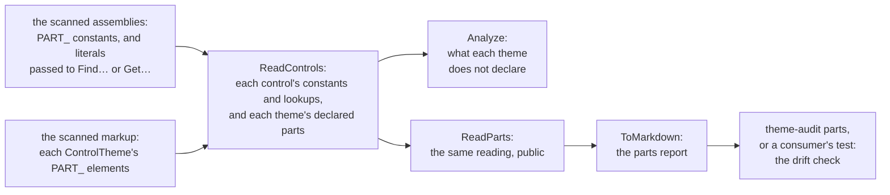

# 00002 — BNXQ1003's reading made public, and the parts report

> Status: **approved 2026-10-13**. Supersedes nothing.

DiffView asked on 2026-10-03 for a public, per-control reading of what `BNXQ1003` reads from compiled
code: each template part a control looks up, apart from the `PART_` constants it only declares, and
whether each lookup is the control's own code or an inherited base class's, with that class's
assembly. Its parts reference, its plan 00030, takes its *looked up* column from that reading and is
parked until a release carries it. DiffView first wrote a reading of its own, and two reviews took it
apart: it read less than the rule does, and its one cross-check agreed with the rule by coincidence.
That is the case for one reading, shared by the rule and its consumers.

XamlQuality owns the theme audit, so the reference DiffView meant to generate for itself belongs here
too, as the audit's second report: the theme audit's tool writes it and checks it, as it does the
first (the developer's decision of 2026-10-13). So this plan has two steps: the reading, then the report.

## What the rule reads today

`TemplatePartRule.ReadControls` is private, and it keeps no provenance. It reads two things from every
type in the scanned assemblies, and pours both into one set of part names per control. `Analyze` then
reads a third from the markup, and compares:

| What it reads | From | Credited to |
|---|---|---|
| A `PART_` string constant | A field of the type, public or not | The outermost type declaring it |
| A `PART_` literal passed to a call whose name starts with `Find` or `Get` | A method body, read as IL by `CompiledStrings.LoadedBy` | Each control that hands the method its template or the template's name scope, from the `OnApplyTemplate` it resolves to, a base class's included (`HandedTemplate`); else the method's own outermost type |
| An element named `PART_…`, in either naming spelling | Each `ControlTheme`, through `ControlThemes.In` and the private `PartsNamedUnder` | The theme's target; compared with the control's parts, then discarded |

So neither the rule nor a consumer can say which parts were looked up, by whose code, or what each
theme declares them as, and a part a constant names and nothing looks up counts the same as one a
lookup needs.

## Decisions

**Step A, the reading:**

| # | Decision | Why |
|---|---|---|
| 1 | **One reading for the rule and its consumers.** `ReadControls` returns the model below, the parts each theme declares included, and `Analyze` derives its findings from it: for each theme of a control, its constants and looked-up parts that the theme does not declare | A second reading of one fact is what drifted at DiffView. The rule's output does not change by a byte, which the real-code comparison and the suite hold |
| 2 | **`TemplatePartRule.ReadParts(XamlScanContext context)`**, a public static method beside `Analyze`, returning a `TemplatePartReading`. It reads the context's markup and assemblies, as `Analyze` does, and nothing else | A consumer that runs the rule already holds the context, so the reading it gets is the one the rule checked. A method on the rule keeps the surface beside what it explains |
| 3 | **The model, six public types in `Bennewitz.Ninja.XamlQuality.Rules`.** `TemplatePartReading(IReadOnlyList<ControlTemplateParts> Controls, IReadOnlyList<XamlSkip> Skipped)`; `ControlTemplateParts(string Name, IReadOnlyList<string> Constants, IReadOnlyList<TemplatePartLookup> Lookups, IReadOnlyList<ThemeParts> Themes)`; `TemplatePartLookup(string Part, TemplatePartOrigin Origin, string Type, string Method, string Assembly)`; `ThemeParts(string File, int? Line, IReadOnlyList<DeclaredPart> Declared)`; `DeclaredPart(string Name, string ElementType, string? AutomationId)`; and `enum TemplatePartOrigin { Own, BaseClass, Helper }` | Records, as `XamlFinding` and `XamlSkip` are, and the skips are `XamlSkip`s. The names become permanent public API at the release that carries them; `Controls` and `ControlTemplateParts` are the developer's (2026-10-13), since the rule checks every entry as a control |
| 4 | **A lookup says where it comes from.** `Origin` is `Own` where the control's code makes it, a lambda or local function it declares included; `BaseClass` where a base class of the control makes it, in whichever scanned assembly; `Helper` where another type makes it, that the control hands its template or name scope to. Beside it: the type whose code makes the lookup, by full name, its outermost declaring type for a closure; the method, by its compiled name, so a closure's is the compiler's, such as `<OnApplyTemplate>b__12_0`; and that type's assembly, by name | DiffView's column is own or inherited, with the class's assembly. Telling a base class from a helper needs the types' relationship, which the reading holds when it credits the lookup. The compiled name is what the IL says and tells two lambdas apart (the developer's decision of 2026-10-13); the report shows a friendlier form |
| 5 | **An entry is every type the rule credits a part to, named as the rule names it**: by the type's simple name, the one a `ControlTheme`'s `TargetType` gives. That is a control, or a helper no control hands its template, whose lookups the rule keeps as its own and names in a skip; a consumer keeps the entries its themes target. Two scanned types of one simple name are one entry, as they are to the rule today, and the reading's remarks say so | The reading says what the rule reads, no more. Keying by full name is a change to the rule's matching, which is a change of its own |
| 6 | **A declared part is what the rule compares**: an element inside the control's own `ControlTheme` named `PART_…` in either naming spelling, with its element's local name and the `AutomationId` it declares, read by `AutomationIdentifier`. One `ThemeParts` per theme, so a control themed twice lists both | The element type and the id are what DiffView's tables show beside each part, and the theme markup the rule already reads holds both |
| 7 | **What the reading could not read is in `Skipped`**, as the rule names it: a control whose code could be read only in part, and a type a scanned assembly defines that did not load, each with why. Given a scan with no assemblies, it reads nothing, and one skip says so | The library's third commitment: zero is not a result on its own, and a reading with no controls must not look like a library with no parts |
| 8 | **Ordered, so two readings compare as text**: controls by name, constants by name, lookups by part, then type, then method, all ordinal; themes by file, then line; a theme's declared parts in the order it declares them | Declaration order is how a theme reads, and as fixed across cultures and platforms as ordinal order; DiffView's plan 00030 chose it for its tables |
| 9 | **`BNXQ1003` does not change what it checks.** A constant that only a selector needs is still checked against its control's theme, and still counts in `Inspected` | Checking only what is looked up would turn findings off for every consumer, a behaviour change of its own. With the reading public, a consumer can already tell the two apart |

**Step B, the report:**

| # | Decision | Why |
|---|---|---|
| 10 | **`TemplatePartReading.ToMarkdown()`** renders the reading: one section per control in its order, then a section naming what was not read. Its columns are Part, then Element and AutomationId (one pair per theme where there are several), Constant, and Looked up by, which reads ✓ for the control's own code, the base class's assembly for a base class, and the helper's type for a helper; a closure shows as its method, `OnApplyTemplate (lambda)`. A part a constant names or a lookup needs that a theme does not declare is marked in that theme's column, which is exactly `BNXQ1003`'s findings; a part two themes declare differently is shown, not failed. LF line endings, invariant culture, no timestamp, no absolute path | A consumer commits it and holds it to a fresh run. The cell convention, the declared order and showing a difference are DiffView's, from its plan 00030 |
| 11 | **The report's format is a contract**, with an invariant row in `AGENTS.md` and a golden test; a change to it is recorded under "Effect on a consumer", as a change to the audit's digest is | Every consumer regenerates its committed copy when the format changes |
| 12 | **The theme audit runs it.** `theme-audit.json` gains an optional `parts` section: `report`, the markup folders to read themes from, and the assemblies, each a path relative to the configuration. `theme-audit parts` writes the report, and with `--check` compares it, as `report` does the audit's. The tool loads the assemblies in an isolated load context that resolves their dependencies from their own folder | One tool regenerates the audit's outputs, and a repository with no test for it still gets the drift check |
| 13 | **The drift check moves into the library.** One call compares a generated output with its committed copy, reading CRLF as LF, and on drift writes the fresh one beside it as `<name>.received.<ext>`. The tool's `report`, `compat` and `parts` use it, their exit codes and messages unchanged | `Program.cs` holds the comparison today, so each consumer's test writes it again, as DiffView's does; `src/AGENTS.md` keeps analysis in the library |

### Dismissed

- **Reading a list of assemblies rather than a scan.** The reading is the rule's, so it takes the rule's
  input: one entry point shaped like `Analyze`, with the same answer when the scan holds no assemblies,
  keeps a consumer from reading other assemblies than it checks.
- **Handing out `Type` and `MethodBase` objects.** They tie a consumer to one load of the assemblies and
  print as runtime noise; names are what a table needs, and `Origin` answers the one question names
  cannot.
- **A closure's method given as its declaring method's name.** Two lambdas in one method would read the
  same, and the mapping rests on compiler naming the rule does not otherwise depend on; the report shows
  the friendly form.
- **A reading of its own type, or a rule that reports it.** It states facts, not violations, and an
  `IXamlRule` result has no place for a table per control.
- **Reading base classes the scan is not given.** The rule reads what it is handed; DiffView already
  hands it AvaloniaEdit's assembly, and the rule then reads AvaloniaEdit's lookups, as DiffView measured.
- **The report generated only by consumers' tests.** The tool regenerates the audit's other outputs, and
  a repository with no test for it would have no drift check.
- **Narrowing `BNXQ1003` to looked-up parts in the same change.** Decision 9.
- **The runtime check of the themes**, DiffView's `ThemeResolutionTests`: it needs Avalonia running. It
  is plan 00003's, a source-only package.

## Scope

**In.** Step A: `TemplatePartRule.ReadParts`; the six public types; `ReadControls` returning
the model, and `Analyze` deriving its findings from it; tests; `AGENTS.md`'s `BNXQ1003` paragraph and an
invariant; a paragraph in the README's rules section, outside the generated table;
`src/XamlQuality/Properties/AssemblyInfo.cs`; `PROGRESS.md`. Step B: `ToMarkdown`, its golden test and
invariant; the drift check in the library; the `parts` section and `theme-audit parts`; the tool's
`report` and `compat` on the drift check; tests; the README's theme audit section; `AGENTS.md` and
`src/AGENTS.md`; `PROGRESS.md`.

**Out.** Any change to what `BNXQ1003` reports or counts; any other rule's reading; DiffView's adoption,
its plan 00030, rewritten on its side; the runtime check of the themes, plan 00003; moving the
Avalonia-specific rules into a package of their own, recorded in `PROGRESS.md` for later; the release,
which is batched after `BNXQ1009`'s `ItemsSource` reading.

## Steps

One concern per pull request, in this order.

| # | Step | Verified by |
|---|---|---|
| 1 | This plan, in a pull request of its own: the plan alone in its approval commit, then `PROGRESS.md`'s requests table and follow-ups pointing at it | The pull request's required checks pass |
| 2 | **Step A, the reading**: `ReadControls` returns the model, `Analyze` derives its findings from it, `ReadParts`, the types, tests and documents | `BNXQ1003`'s tests in `TemplatePartRuleTests` and `UnloadableBuildOutputTests` pass unedited, and the rest of the suite with them. New tests: a lookup in the control's own code (`Own`), in a lambda it declares (`Own`, its compiled name), in a base class's `OnApplyTemplate` in the test assembly and in one emitted at test time (`BaseClass`, with that assembly's name), in a helper handed the template, and in one handed only its name scope (`Helper`); a method no control hands its template, whose lookups stay its own type's (`Own`); a constant nothing looks up, in `Constants` and in no lookup; declared parts with their element and `AutomationId`, in either naming spelling and in declaration order; a control themed twice, listing both themes; a control read only in part and a type that does not load, over `UnloadableAssembly`, in `Skipped`; a scan with no assemblies; and the agreement itself: over the test assembly, `Analyze`'s findings for every theme are exactly the constants and looked-up parts the reading lists that the theme does not declare. Each new test fails when the behaviour it covers is planted out by `tools/mutate.cs`, and so does each mutation planted in the crediting code. `AssemblyQualityTests` pass with the new public types. `tools/real-code.cs` prints every record unchanged. Over DiffView's pinned build, given AvaloniaEdit's assembly too, every lookup the reading lists is read against DiffView's source at that commit; the counts are set beside the 34 lookups of its own and the 11 of AvaloniaEdit's that its plan 00030 measured; and the three that plan names are there as it measured them: `TextArea`'s `PART_CP` and `TextEditor`'s `PART_ScrollViewer` from AvaloniaEdit's assembly, and `DiffPanePresenter`'s literal `PART_ScrollViewer` from DiffView's own |
| 3 | **Step B, the report and the drift check**: `ToMarkdown`, the drift check, the `parts` section and `theme-audit parts`, the tool's `report` and `compat` on the drift check, tests and documents | A golden test of `ToMarkdown` over a reading that covers every column: each origin, a lambda, two themes that declare a part differently, a part no theme declares, a skip; byte-identical on Linux, Windows and macOS, which CI's matrix runs. The drift check's tests: up to date; stale, with the received file written; missing; a CRLF copy that reads as up to date. Nothing tests the tool's `report --check` and `compat --check` today, so tests of their exit codes and messages are written first, against today's `Program.cs`, and pass unedited once both run on the drift check. `theme-audit parts` over DiffView's pinned build output and AvaloniaEdit's assembly writes a report naming the three lookups step 2 names, and `--check` exits 0 on it and 1 after one edit to it. `tools/mutate.cs` over the renderer and the drift check |

Each pull request updates `PROGRESS.md` in the same change.
